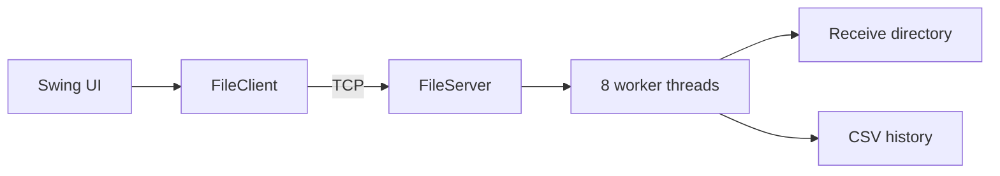

# LAN File Sharing Application

A beginner-oriented Java Swing application for exchanging files directly between two devices. A user creates a group or joins another device's Wi-Fi hotspot; either participant can then send and receive files. File transfer uses the local network and does not require an Internet connection once both devices are connected to the same group.

## Features

- Dashboard with server status, local IP, live connected-client count, total received files/bytes, and recent filenames.
- Two prominent Create Group and Join Group actions on Overview. Each action starts that device's peer services and opens Windows network settings to help establish the Wi-Fi link.
- Either group participant can send and receive. UDP discovery lists active ShareLAN peers; manual host/port entry remains available.
- TCP file transfer with live progress, bytes transferred, and speed shown on both the sender and receiver; data streams in 64 KiB buffered chunks.
- Receiver with a fixed pool of eight workers, safe filename checks, available-disk-space checks, partial-file cleanup, and collision-safe destination naming. There is no application-level file size cap.
- CSV transfer history with filename search.
- Recursive folder-walking demonstration and JUnit tests. A small command-language parser remains as a course-code example; its console has been removed from the app interface.

## Architecture



A TCP socket is a reliable connection between two programs. The sender writes a Java UTF filename and a 64-bit byte count. The receiver checks the filename and available disk space, then replies `READY`; only then does the sender stream the file bytes. The receiver replies `OK` when saving is complete. TCP handles byte ordering and retransmission. There is no application-level size cap; practical size depends on available storage and file-system limits. The receiver checks free space before accepting the body. This application has no encryption or authentication and is intended only for trusted LANs.

## Networking and concurrency

The accept thread waits for connections. Each connected socket is submitted to an eight-thread `ExecutorService`; this bounds the number of simultaneous handlers. The GUI sends from a background executor so Swing can redraw. A concurrent set tracks active sockets, an atomic counter tracks clients, and synchronized CSV operations prevent overlapping repository writes. GUI updates use `SwingUtilities.invokeLater`.

## Project structure

`src/main/java/com/lanshare/`: `Main` (GUI); `network/` (`FileClient`, `FileServer`, `LanDiscovery`); `model/` (`Transfer`); `storage/` (repository interface and CSV implementation); `service/` (`FolderWalker`); `parser/` (`CommandInterpreter`); `util/` (validation). Tests are in `src/test/java`.

## Build and run

Requires JDK 17+ and Maven 3.9+.

```sh
mvn clean test
mvn package
java -jar target/lan-file-sharing-1.0.0.jar
```

On the host computer, open Overview and click **Create Group**. Windows Mobile Hotspot settings will open; turn on the hotspot manually. On the other computer, click **Join Group** and connect to that hotspot in Windows Wi-Fi settings. Both apps start their peer receiver and discovery services, so either device can send to the other. Choose a file from **Send files** and use the progress/speed indicators to follow the transfer. Received files default to `downloads/`; history is stored in `data/history.csv`.

Open **Send files** and click **Find devices**. Choose the peer and click **Connect to selected device**; ShareLAN discovers active group peers by UDP broadcast on port 5051 and opens the TCP transfer connection. Discovery can be blocked by Wi-Fi client isolation, firewall rules, or network broadcast filtering. In that case, type the peer's IP address and port manually. Permit UDP 5051 and TCP 5050 (or the selected transfer port) through the firewall.

Windows controls whether Mobile Hotspot is enabled; ShareLAN opens the relevant Settings page but does not silently toggle the hotspot. The app's local file transfer does not use Internet services. The devices still need an active local Wi-Fi connection between them, and some network configurations may block peer-to-peer traffic.

The transfer protocol works without Internet access once both computers have a local Wi-Fi link. Whether Windows can create its hotspot with no active upstream connection depends on the Windows configuration and Wi-Fi adapter. If it cannot, use a phone hotspot with no mobile data or a local access point/router without Internet, provided it allows devices to communicate with each other.

## Course concept mapping

| Concept | Actual implementation |
|---|---|
| Static checking and Java | Java 17 compiler target in `pom.xml`; classes, methods, exceptions |
| Specifications | Protocol framing and validation preconditions in network and utility classes |
| Mutability and immutability | Server/client state changes; immutable `Transfer` record |
| ADT and interface | `TransferRepository` abstracts the CSV representation |
| Equality and IDs | Record equality; transfer identifier is a UUID |
| Recursion | `FolderWalker.walk` visits nested directories recursively |
| Regex, grammar, little language | Filename regex and standalone `CommandInterpreter` example: `LIST FILES`, `SHOW HISTORY`, `STATUS`, `SEARCH "text"`, `HELP`; it is not exposed in the GUI |
| Parser generator | ANTLR is not used: direct comparisons and regex keep this tiny grammar dependency-free |
| Concurrency/thread safety | Fixed worker pool, atomic count, concurrent socket set, synchronized repository |
| Queue and message passing | Executor's task queue and framed request/reply socket protocol |
| Locks | Java monitor acquired by synchronized CSV repository methods |
| GUI and collection operations | Swing tabs; stream `filter` searches filenames, `map` extracts them, and `sum` reduces byte totals |
| Testing/debugging/review/versioning | JUnit tests, manual smoke transfer, `.gitignore`, documented validation and failure paths |

The folder walker is an independent recursion demonstration and does not send folders. `ClientCollection` and a separate `TransferQueue` are not necessary because the concurrent set and executor queue already provide those roles.

For a source-by-source explanation and a requirement-by-requirement viva walkthrough, see [docs/PROJECT_WORKFLOW_AND_CODE_GUIDE.md](docs/PROJECT_WORKFLOW_AND_CODE_GUIDE.md).

## Limitations and troubleshooting

- JUnit tests run with `mvn clean test`. In the prepared environment Maven is absent, so JUnit has not been executed there.
- If connection fails, check that both machines share a reachable LAN, use the receiver's LAN IP, use the same port, and allow inbound TCP through the firewall.
- Choose the receive directory before starting the server; changes apply on the next start. Port is editable in Connect & Send. Very large files depend on free disk space and the available filesystem capacity.
- No encryption, authentication, transfer resume, folder sending, or public Internet relay. Offline transfers work only when the operating system and Wi-Fi hardware provide a local hotspot/group connection. Cross-device behavior should be verified on the target devices.
