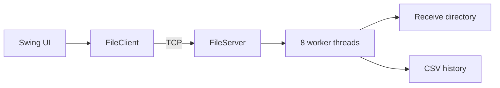

# LAN File Sharing Application

A beginner-oriented Java Swing application for sending files over a trusted local network. One computer starts the receiver; another discovers it or enters its IP address and port, then selects a file. The receiver saves the file and records successful transfers.

## Features

- Dashboard with server status, local IP, live connected-client count, total received files/bytes, and recent filenames.
- Two large, colorful Send and Receive action cards at the front of the Overview; other information appears below. The main content scrolls when it does not fit.
- UDP LAN discovery so a sender can find active ShareLAN receivers and connect from a device list; manual host/port entry remains available.
- TCP file sending with a live percentage, bytes-sent count, transfer speed, 64 KiB buffered chunks, and binary-safe framing.
- Receiver with a fixed pool of eight workers, safe filename checks, available-disk-space checks, partial-file cleanup, and collision-safe destination naming. There is no application-level file size cap.
- CSV transfer history with filename search.
- Recursive folder-walking demonstration and JUnit tests. A small command-language parser remains as a course-code example; its console has been removed from the app interface.

## Architecture



A TCP socket is a reliable connection between two programs. The sender writes a Java UTF filename and a 64-bit byte count. The receiver checks the filename and available disk space, then replies `READY`; only then does the sender stream the file bytes. The receiver replies `OK` when saving is complete. TCP handles byte ordering and retransmission. There is no application-level size cap; practical size depends on available storage and file-system limits. The receiver checks free space before accepting the body. This application has no encryption or authentication and is intended only for trusted LANs.

## Networking and concurrency

The accept thread waits for connections. Each connected socket is submitted to an eight-thread `ExecutorService`; this bounds the number of simultaneous handlers. The GUI sends from a background executor so Swing can redraw. A concurrent set tracks active sockets, an atomic counter tracks clients, and synchronized CSV operations prevent overlapping repository writes. GUI updates use `SwingUtilities.invokeLater`.

## Project structure

`src/main/java/com/lanshare/`: `Main` (GUI); `network/` (`FileClient`, `FileServer`); `model/` (`Transfer`); `storage/` (repository interface and CSV implementation); `service/` (`FolderWalker`); `parser/` (`CommandInterpreter`); `util/` (validation). Tests are in `src/test/java`.

## Build and run

Requires JDK 17+ and Maven 3.9+.

```sh
mvn clean test
mvn package
java -jar target/lan-file-sharing-1.0.0.jar
```

On the receiving computer, open Overview and start receiving. The default port is 5050. On the sending computer, open Send files, enter the receiver's LAN address and port if needed, then choose a file. Allow inbound TCP on the receiver's firewall. Use the receiver's LAN IP; `127.0.0.1` only refers to the same computer. Received files default to `downloads/`; history is stored in `data/history.csv`.

Alternatively, open **Send files** and click **Find devices**. Choose a receiver from the list and click **Connect to selected device**; the app discovers active receivers by UDP broadcast on port 5051 and opens the TCP transfer connection. Discovery can be blocked by Wi-Fi access-point isolation, a firewall, or a network that filters broadcasts. In that case, type the receiver's IP address and port manually. Permit UDP 5051 and TCP 5050 (or the selected transfer port) through the receiving computer's firewall.

The latest interface calls the main page **Overview** and the transfer page **Send files**. The Receive action starts/stops the receiver from Overview. Its card also displays the receiver's local address for manual connections. Transfer speed is an average since the current send began, refreshed as data is written.

## Course concept mapping

| Concept | Actual implementation |
|---|---|
| Static checking and Java | Java 17 compiler target in `pom.xml`; classes, methods, exceptions |
| Specifications | Protocol framing and validation preconditions in network and utility classes |
| Mutability and immutability | Server/client state changes; immutable `Transfer` record |
| ADT and interface | `TransferRepository` abstracts the CSV representation |
| Equality and IDs | Record equality; transfer identifier is a UUID |
| Recursion | `FolderWalker.walk` visits nested directories recursively |
| Regex, grammar, little language | Filename regex and standalone `CommandInterpreter` example: `LIST FILES`, `SHOW HISTORY`, `STATUS`, `SEARCH "text"`, `HELP`; it is not exposed in the GUI |
| Parser generator | ANTLR is not used: direct comparisons and regex keep this tiny grammar dependency-free |
| Concurrency/thread safety | Fixed worker pool, atomic count, concurrent socket set, synchronized repository |
| Queue and message passing | Executor's task queue and framed request/reply socket protocol |
| Locks | Java monitor acquired by synchronized CSV repository methods |
| GUI and collection operations | Swing tabs; stream `filter` searches filenames, `map` extracts them, and `sum` reduces byte totals |
| Testing/debugging/review/versioning | JUnit tests, manual smoke transfer, `.gitignore`, documented validation and failure paths |

The folder walker is an independent recursion demonstration and does not send folders. `ClientCollection` and a separate `TransferQueue` are not necessary because the concurrent set and executor queue already provide those roles.

For a source-by-source explanation and a requirement-by-requirement viva walkthrough, see [docs/PROJECT_WORKFLOW_AND_CODE_GUIDE.md](docs/PROJECT_WORKFLOW_AND_CODE_GUIDE.md).

## Limitations and troubleshooting

- JUnit tests run with `mvn clean test`. In the prepared environment Maven is absent, so JUnit has not been executed there.
- If connection fails, check that both machines share a reachable LAN, use the receiver's LAN IP, use the same port, and allow inbound TCP through the firewall.
- Choose the receive directory before starting the server; changes apply on the next start. Port is editable in Connect & Send. Very large files depend on free disk space and the available filesystem capacity.
- No encryption, authentication, transfer resume, folder sending, or public internet support. Cross-device and GUI behavior require a desktop and second LAN host.
