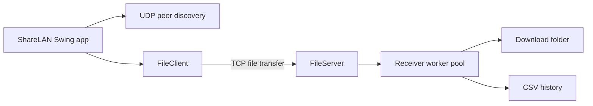

# ShareLAN

**Send files directly between computers connected to the same Wi-Fi network.** ShareLAN is a Java desktop application with automatic peer discovery, direct TCP transfers, and a modern sender and receiver interface.

## Features

- Prominent **Send files** and **Receive files** actions on the Overview.
- Automatic peer discovery, with manual IP address and port as a fallback.
- Bidirectional file sharing: either computer can send or receive.
- Live progress and transfer speed on both sender and receiver screens.
- Modern in-app message and file-selection dialogs.
- No application-level file-size cap; practical limits depend on available disk space and the filesystem.
- Download folder selection and searchable CSV transfer history.

## Quick start

Requires JDK 17 or later and Maven 3.9 or later.

```sh
mvn clean package
java -jar target/lan-file-sharing-1.0.0.jar
```

1. Connect both computers to the **same Wi-Fi network**. The router must allow devices to communicate with one another.
2. On the receiving computer, click **Receive files** on the Overview to start its receiver.
3. On the sending computer, click **Send files**. ShareLAN starts searching; select the receiver and click **Connect**.
4. After the connection confirmation, click **Choose a file**. Both computers show progress and speed on the Overview. Received files are saved to `downloads/` by default.
5. To send in the other direction, start receiving on the other computer and repeat.

## How it works



Peers discover one another with UDP broadcast on port `5051`. Files travel over TCP, normally on port `5050`. The sender sends the filename and file size, waits for the receiver to approve, streams the bytes in buffered chunks, and waits for the receiver's completion reply. The sender and receiver each display progress and average speed on the Overview. Completed sends and receives are recorded in local CSV history.

File transfer does not require Internet access, but both computers must have a local network connection that lets them communicate. A Wi-Fi network with client isolation enabled may block discovery or transfers.

## Build and tests

```sh
mvn clean test
mvn package
```

The project targets Java 17 and uses JUnit 5. The runnable JAR is created at `target/lan-file-sharing-1.0.0.jar`.

## Troubleshooting

- **No devices found:** confirm both computers use the same Wi-Fi network. Check router client isolation, firewall rules, and UDP port `5051`.
- **Connection fails:** confirm the receiver is running, use its local IP address and matching TCP port, and allow inbound TCP traffic (default port `5050`).
- **Large file fails:** ShareLAN has no fixed size cap. Check available disk space and filesystem limits.

## Technical notes

- `Main` builds the Swing interface and coordinates networking, history, and progress updates.
- `FileClient` sends files; `FileServer` validates and receives them.
- `LanDiscovery` finds receivers on the local network.
- The receiver uses a bounded worker pool; CSV history writes are synchronized.
- `FolderWalker` and `CommandInterpreter` are course-concept examples and are not exposed in the GUI.
- Transfers have no encryption, authentication, or resume support. Use ShareLAN on a trusted local network.
